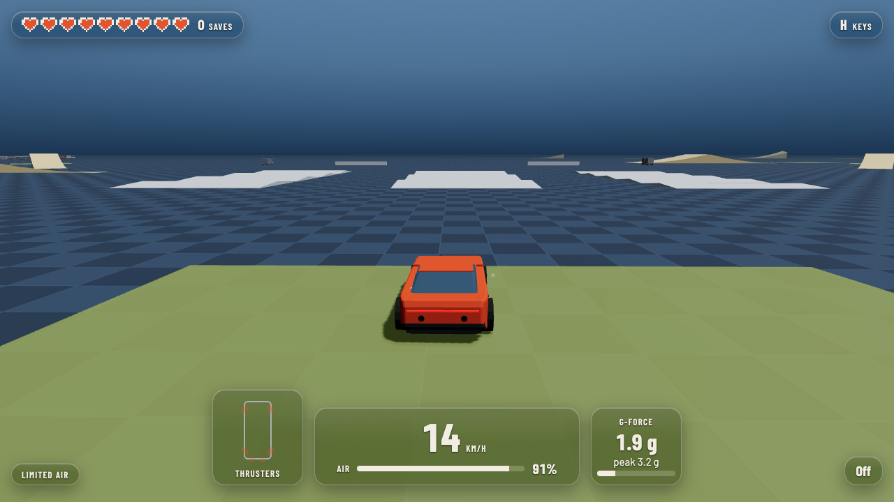
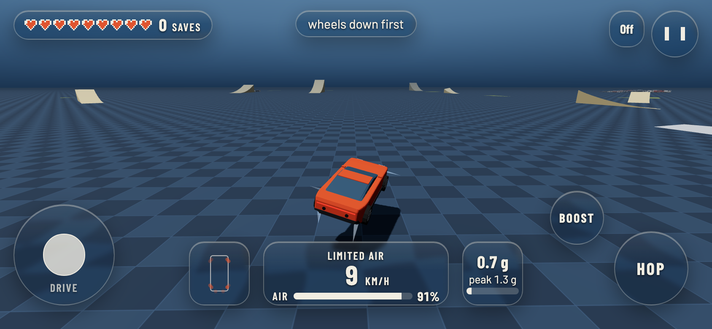
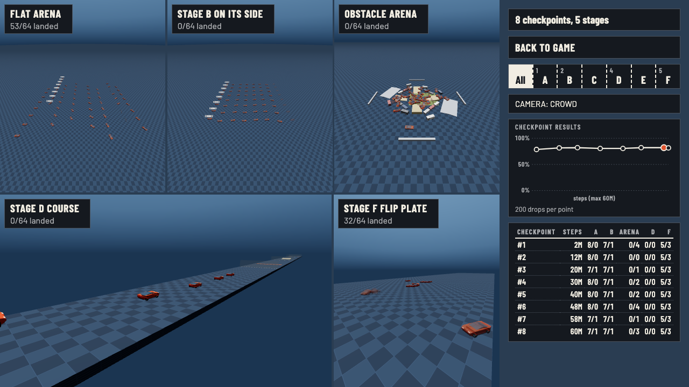
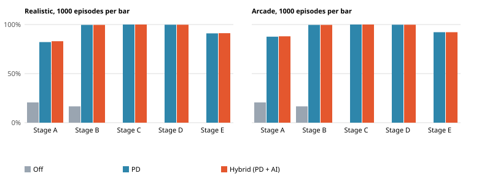

# Nine Lives

A browser driving game where a car fires 10 cold-gas air nozzles to flip itself upright in mid-air and land on its wheels.

> Inspired by the thruster-assisted Roadster demo of October 2026. This is a generic low-poly car and an independent project: no affiliation with Tesla or SpaceX, and no logos or names from either. The numbers are plausible, not official.

## Play

Open the live demo: TODO (the owner adds the link once the game is hosted).

| Key | Action |
|---|---|
| Arrow keys | drive, brake, steer |
| Space | hop |
| Shift | boost |
| A / S | barrel roll left / right |
| D / F | front flip / back flip |
| X | drop test: throw the car into a random bad start |
| M | switch between Limited air and Unlimited air |
| V | change the wind |
| Esc | pause |

R puts the car back on the road. A stunt key is a request: the car only starts the move if it can still finish it and land. You can press stunt keys again during a jump to add moves, up to 3 per jump (a double back flip, a triple barrel roll, a flip then a roll). The toast names the move. If the air or time runs short, the toast says "not enough air" or "not enough time".

On a phone (landscape): the left thumb drives with a floating stick, HOP and BOOST sit bottom-right. In the air, twist the phone to roll or flick it to flip, or swipe on the right half. Tap the wind readout or the air-mode label instead of V and M; the pause button has Drop test.
On a gamepad: triggers drive, left stick steers, A hop, B boost, bumpers roll, Y and X flip, Start pauses.

You have nine lives. The "watch the AI train" link opens the training viewer, and its "back to game" button returns you to the game with the lives you had lost kept as they were. A new tab starts with nine.

## Deploy

Railway builds the root `Dockerfile` from this repo (`railway.json`): a Rust and Node stage builds the wasm and `web/dist`, and nginx serves it. The health check path is `/healthz`. nginx listens on the `PORT` variable, which Railway sets (the image defaults to 8080). There is no server or database.

CI builds the same image and smoke-tests it. To check a running deploy yourself:
`deploy/smoke.sh https://<your-app>.up.railway.app`

## Limited air and Unlimited air

The car carries an air tank of 260 kg (`air_left_kg` in `results/eval_off_A_realistic.json`). Every nozzle burst uses some of it.

- **Limited air:** the tank drains while you fire and refills slowly once the wheels are down and the nozzles are quiet. If it runs dry, the car cannot right itself. This is the default.
- **Unlimited air:** the tank never empties and the nozzles push twice as hard. Air use is still counted.

In code, result files and settings, Limited air is `realistic` and Unlimited air is `arcade`, as in `results/eval_pd_A_realistic.json`.

## How it works

- **The car.** A simulated car with four wheels and 10 air nozzles. The physics is Rust, compiled to WebAssembly so it runs in your browser, at a fixed 120 steps per second. The same inputs always give the same result.
- **The safety net.** A plain controller called PD steers the car back toward upright in proportion to how far off it is and how fast it is turning. It flies alone below 120 degrees of tilt and above 55 m/s.
- **The trained AI.** A small neural network trained in simulation by trial and reward. When the car tips more than 120 degrees from upright, it takes over from PD. The game flies PD plus the AI by default, with the AI active up to 55 m/s; `?controller=pd` gives PD alone.
- **Training stages.** Stage A is a drop from a random bad start. B to E add ramps, walls, gaps and obstacles. F mixes everything.

## What we found

All numbers are success rates over 1000 fixed episodes per cell (four wheels down and quiet for a second), read from `results/eval_<controller>_<stage>_<mode>.json`, field `summary.success_rate`.

- With no controller, 20.6% of Stage A drops end on four wheels (`eval_off_A_realistic.json`). PD raises that to 82.1% in Limited air (`eval_pd_A_realistic.json`) and 87.6% in Unlimited air (`eval_pd_A_arcade.json`).
- The trained AI (R4 policy in these files) does not beat PD everywhere. On Stage A with Limited air, PD plus the AI gets 80.8% against PD's 82.1% (`eval_hybrid_A_realistic.json`). It uses less air per save though: 43 kg against 49 kg (`summary.air_per_save_kg` in the same two files).
- Stages B, C and D are level between the two: 99.6%, 100.0% and 99.8%. Stage E is 91.0% for PD and 91.3% with the AI (matching `eval_pd_*` and `eval_hybrid_*` files, Limited air).
- **The hover hack.** We trained the same car twice for about 12 million steps on Stage A in Unlimited air. One reward paid +0.1 for every step spent upright. The other paid only for landing and charged for air. With the first reward, 37.0% of drops were still in the air when the 8 second clock ran out. With the second, none were. Mean air used was 135 kg against 35 kg (`results/hover_hack.json`, `broken` and `fixed`). One seed; it measures time-outs and airtime, not the car's attitude.
- **The retrained AI (r5, shipped).** The files above were made with the previous policy (R4) on the older Stage A and F drops. The r5 policy was trained on wider Stage A and F drops (more flip plate types, harder starts) and evaluated on three fresh blocks of 1000 episodes per cell, Stages A to F, both modes (`results/flight-r5_2026-11/`, field `summary.success_rate`). On seeds 4,000,000 and up the 12-cell mean on the wider drops goes from 90.54% to 91.28%, and Stage F with Limited air from 58.1% to 66.0% (the other two blocks: 59.9% to 67.2% and 61.3% to 67.4%). Stage F with Unlimited air slips a little, 77.3% to 76.9%.
- **Where it is still weak.** The mixed roll-and-flip plate. On seeds 4,000,000 and up (241 cars) r5 lands 29.5% of them in Limited air (the old policy 22.4%, a gain of about 1.8 standard errors) and 38.6% in Unlimited air (the old policy 39.0%); in Unlimited air r5 is slightly worse than the old policy on all three blocks (`by_preset` in `results/flight-r5_2026-11/`). A second training round aimed at it (r6) did not fix it and lost 3.9 points on Stage F with Unlimited air, so it was not shipped. The promotion rule was changed after the first result came in; see [docs/DECISIONS.md](docs/DECISIONS.md) (2026-11-09).

Full tables and runs: [docs/EXPERIMENTS.md](docs/EXPERIMENTS.md). File index: [results/README.md](results/README.md).

## How it was built

The work followed a milestone plan ([docs/BUILD-PLAN.md](docs/BUILD-PLAN.md)). Experiments are in [docs/EXPERIMENTS.md](docs/EXPERIMENTS.md), design choices with reasons in [docs/DECISIONS.md](docs/DECISIONS.md), and the AI in plain words in [docs/AI-IN-PLAIN-WORDS.md](docs/AI-IN-PLAIN-WORDS.md).

- **Same physics everywhere.** Training and the browser use one Rust crate. A frozen test run (the golden trace) must match on native and WebAssembly builds.

## Limits

- Frame rate on a real GPU has not been measured. The 60 fps figures come from software rendering in headless Chromium.
- The training viewer cannot show Stages C and E, because each seed builds its own course.
- Stage A is the hard one: with PD in Limited air, 17.9% of drops still crash (`crash_rate` in `results/eval_pd_A_realistic.json`).
- The hover-hack runs are small: one seed each, 200 drops.

## Credits

- Inspired by the thruster-assisted Roadster demo of 2026-10-15: [TechCrunch](https://techcrunch.com/2026/10/15/tesla-reveals-spacex-powered-roadster-that-flies-and-falls-with-style/), [Glitchwire](https://glitchwire.com/news/the-tesla-roadster-hovered-flipped-and-landed-the-air-tank-weighed-260-kilos/).
- Fonts: [Barlow and Barlow Condensed](https://github.com/jpt/barlow), SIL Open Font License 1.1.
- Built with [Rapier](https://rapier.rs/) (physics), [three.js](https://threejs.org/) (graphics) and [Stable-Baselines3](https://stable-baselines3.readthedocs.io/) (PPO training).
