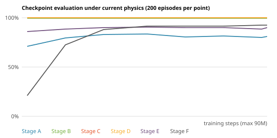
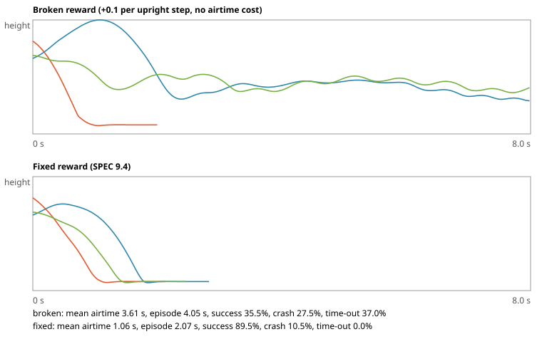

# Nine Lives

A browser driving game where an AI fires a car's 10 cold-gas thrusters so it always lands on its wheels.

> Inspired by the thruster-assisted Roadster demo of October 2026. This is a generic low-poly car and an independent project: no affiliation with Tesla or SpaceX, and no logos or names from either. The numbers are plausible, not official.


You drive recklessly. The controller owns all 10 nozzles and fires them on its own: it spins the car back to upright in the air, spends as little air as it can, and sets the car down on four wheels. You press Hop and Boost, ask for a stunt (barrel roll, front flip, back flip), and watch the g-meter.

Everything runs in your browser. The physics is Rust compiled to WebAssembly, the same code that trained the AI. There is no server.

## Play

```bash
cd web && npm install && npm run wasm && npm run dev    # http://localhost:5173
```

| Key | Action |
|---|---|
| ↑ ↓, ← → | drive, brake, steer (arrows only) |
| Space, Shift | Hop, Boost |
| A / S | barrel roll left / right (the planner only agrees if the car can also land) |
| D / F | front / back flip |
| X | drop test: throw the car into a random Stage A start and watch it save |
| M, V | Limited air / Unlimited air, wind level |
| Esc, F3 | pause, frame-rate overlay (R also respawns, unlisted) |

**Watch the AI train** (the link in the corner, or `viewer.html`) replays eight checkpoints of the policy at once: a crowd of cars per checkpoint, dropped from the same starts, so you can see the same drop go from a crash to a clean landing as training goes on. All five stages run at once; click a title, a tab or press 1-5 to focus one, Esc to see all, L for the leader camera.


## How it works

```
 configs/*.toml, courses/*.json
            │
   nl-sim  (Rust, rapier)   the only physics, events, observations and reward
   nl-control (PD + allocation, Hybrid gate)     nl-policy (MLP forward pass)
        │ PyO3                                         │ wasm-bindgen
   Python: Gymnasium + PPO training, eval, export      web: three.js, HUD, input
        └──────────── models/policy.json ──────────────►
```

- **Simulation.** A raycast vehicle with 10 nozzles, an air tank, a bump stop and wheel contacts, stepped at a fixed 120 Hz and deterministic: a golden trace is checked on native and wasm.
- **Two controllers.** A classical PD attitude controller with thruster allocation, and an RL policy (PPO, 43 observations, 10 throttles). The game flies **Hybrid** when you ask for the AI: PD flies until the car is more than 120° off upright, then the policy takes over.
- **Stunts.** A request is never a trigger. A landing forecast and a planner decide whether the car can finish the rotation and still land; if not, the key lapses and nothing happens.
- **g-meter.** The seat g-load, with the raw per-tick peak of each stunt window (the touchdown counts).
- **Survival contract.** A clean entry to any covered ramp, wall or gap up to 200 km/h never crashes (a one-seed sweep of 768 runs guards it in CI).

## Results

Success rate on fixed seeds, 1000 episodes per bar: four wheels down, quiet throttle, held for a second. Every number comes from `results/eval_*.json` (see [results/README.md](results/README.md)).


| Stage | Mode | Off | PD | Hybrid | PD air per save | Hybrid air per save |
|---|---|---|---|---|---|---|
| A | realistic | 20.6% | 82.1% | 80.8% | 49 kg | 43 kg |
| A | arcade | 20.6% | 87.6% | 85.6% | 58 kg | 51 kg |
| B | realistic | 16.6% | 99.6% | 99.6% | 27 kg | 27 kg |
| B | arcade | 16.6% | 99.6% | 99.6% | 34 kg | 34 kg |
| C | realistic | - | 100.0% | 100.0% | 10 kg | 10 kg |
| C | arcade | - | 100.0% | 100.0% | 37 kg | 37 kg |
| D | realistic | - | 99.8% | 99.8% | 9 kg | 9 kg |
| D | arcade | - | 99.8% | 99.8% | 9 kg | 9 kg |
| E | realistic | - | 91.0% | 91.3% | 16 kg | 15 kg |
| E | arcade | - | 92.2% | 91.6% | 24 kg | 23 kg |

**What the numbers say, plainly:** PD alone is already strong, and the trained policy does **not** beat it everywhere. The Hybrid is level with PD on Stages B to D and a little behind on Stage A (80.8% against 82.1% in Realistic) and on the Arcade cells of A and E; it uses less air per save on Stage A (43 kg against 49 kg). With domain randomization (a harder, noisier start) the Hybrid was ahead of PD in the October validation run: 92.1% against 88.7% over the 12 cells (before the last physics fix; docs/EXPERIMENTS.md), which is where the policy earns its place. The full story and every run are in [docs/EXPERIMENTS.md](docs/EXPERIMENTS.md).

The viewer's curve shows how the shipped policy's checkpoints fly today:



## The hover hack

An RL agent finds the cheapest way to collect reward. If being alive pays, hovering is the cheapest way to stay alive. We trained the same car twice, with identical settings, on Stage A in Arcade (unlimited air) for 12 million steps (about 10 to 13 minutes each):

- **Broken reward:** +0.1 per step while upright, and no airtime cost.
- **Fixed reward:** the default one: pay for landing, charge for air and airtime, never pay for merely surviving.

| 200 fixed drops, hardest Stage A level | Broken reward | Fixed reward |
|---|---|---|
| Landed and settled | 35.5% | 89.5% |
| Crashed | 27.5% | 10.5% |
| Still flying at the 8 s time limit | **37.0%** | 0.0% |
| Mean time in the air | 3.61 s | 1.06 s |
| Longest time in the air | 8.0 s | 1.9 s |
| Mean air used | 135 kg | 35 kg |

With the survival bonus, more than a third of the drops never end: the policy is still flying when the 8 s clock runs out (we measured time-outs and airtime, not the car's attitude). With the default reward no episode times out and the car is down in about a second.



Pay for landing, charge for airtime, never pay for merely surviving. The small budget is deliberate: this is a demonstration of reward design, not a shipped policy. The fixed run is not the shipped policy either (that one is `models/policy.json`, trained on Stages A, D, E and F). Details in [docs/EXPERIMENTS.md](docs/EXPERIMENTS.md). The figure shows height traces instead of video clips.

## Limits

- The AI does not beat PD on every stage and mode (see above). The game flies PD alone by default; the Hybrid (PD plus the policy) is opt-in with `?controller=hybrid`.
- Stages B and C were never trained (PD flies them, the Hybrid hands over only past 120°). Stage A is the hard one for everyone: about 19% of the hardest Stage A drops (Hybrid, Realistic) still end in a crash.
- Physics numbers are plausible, not official. Air, thrust and mass are tuned for play.
- The AI is only trusted inside the speed range it was trained on (55 m/s observed speed); above it, PD takes over.
- The training viewer cannot show Stages C and E: each seed builds its own course, so cars cannot share one drawn course.
- The hover-hack runs are small (12 million steps, one seed each, a single fixed set of 200 drops), so treat the numbers as a demonstration, not a benchmark.
- On a slow machine the sim runs in slow motion rather than dropping frames (at most 8 ticks per frame).

## Not verified

- The Docker image has not been built end to end here (`docker build` and `docker run` below are untested); the web build, the size budget and the nginx config are checked separately.
- Frame rate on a real GPU: the 60 fps figures come from software rendering in headless Chromium, not from measured hardware.

## Deploy

A static site: no game server, no API.

```bash
docker build -t ninelives .
docker run --rm -p 8080:8080 -e PORT=8080 ninelives      # http://localhost:8080
```

The `Dockerfile` builds the release wasm (about 1 MB gzipped against the 2.5 MB budget, checked by `npm run size` and in CI) and serves `web/dist` with nginx, with the `application/wasm` MIME type. `railway.json` points Railway at it; the container listens on `$PORT` and answers `/healthz`.


## Developer setup

You need Rust (stable), Python 3.11 or 3.12, and Node 22.12 or newer.

```bash
# Rust
rustup target add wasm32-unknown-unknown
cargo install wasm-bindgen-cli --version 0.2.129 --locked   # must match Cargo.lock
cargo fmt --all
cargo clippy --workspace --all-targets -- -D warnings
cargo test --workspace

# Python (from the repo root)
python3.12 -m venv .venv && source .venv/bin/activate
pip install -r python/requirements-dev.lock
pip install -e python
maturin develop --release -m crates/nl-py/Cargo.toml
ruff check python && pytest python/tests

# Web
cd web && npm install
npm run wasm          # builds crates/nl-wasm into web/src/wasm
npm run dev           # local page at http://localhost:5173
npm run lint && npm run build
npx playwright install chromium && npm run test:e2e
```

## Credits and sources

- Inspired by the thruster-assisted Roadster demo of 2026-10-15: [TechCrunch](https://techcrunch.com/2026/10/15/tesla-reveals-spacex-powered-roadster-that-flies-and-falls-with-style/), [Glitchwire](https://glitchwire.com/news/the-tesla-roadster-hovered-flipped-and-landed-the-air-tank-weighed-260-kilos/). No affiliation; no logos or names from either company.
- Fonts: [Barlow and Barlow Condensed](https://github.com/jpt/barlow) (SIL Open Font License 1.1, latin subset, self-hosted in `web/src/fonts/` with the licence text).
- Built with [rapier](https://rapier.rs/) (physics), [three.js](https://threejs.org/) (graphics), [Stable-Baselines3](https://stable-baselines3.readthedocs.io/) PPO, [PyO3](https://pyo3.rs/) / maturin and wasm-bindgen.
- Specification, plan, decisions and every training run: [SPEC.md](SPEC.md), [docs/BUILD-PLAN.md](docs/BUILD-PLAN.md), [docs/DECISIONS.md](docs/DECISIONS.md), [docs/EXPERIMENTS.md](docs/EXPERIMENTS.md), [docs/TECHNICAL.md](docs/TECHNICAL.md), [docs/TRAINING.md](docs/TRAINING.md). Index of all docs: [docs/README.md](docs/README.md); index of result files: [results/README.md](results/README.md).
